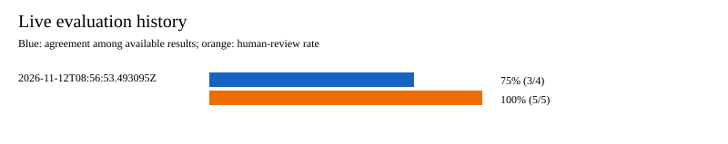

# AI integration: persona evaluation evidence

This section is ready to adapt for the team's final project document. It describes a
single **2026-11-12** evaluation run using five curated historical demo cases. The
expected labels are the team's judgments for the demo, not legal conclusions or a
representative measure of model accuracy.

## How the evaluation works

The development-only seed creates Students A, B and C, two employees linked to a
manager, an admin, and four saved policy documents. Offline scenario tests stub the
generation and independent-review calls. They check that the assessment receives the
correct policy text, consented profile details, and expected fixed response; they do
not test real AI accuracy. The separate opt-in run calls the configured generation
model and independent judge once per scenario, then records the returned urgency,
judge verdict, and human-review flag.

Run the offline scenarios with `./mvnw -Dtest=DemoScenarioTests test`.
The seed integration test is `DemoSeedIntegrationTest`. The full Maven `verify` and
dashboard tests also passed on this branch against an isolated PostgreSQL database.
Setup, commands, fixture provenance, and scenario assumptions are documented in
[persona-demo-evaluation.md](persona-demo-evaluation.md). The independent judge's
rubric and limits are documented in [ai-output-evaluation.md](ai-output-evaluation.md).

## One opt-in live-model run

The run started at **2026-11-12 08:56:53 UTC**. The generation model reported
`gpt-6.1-sol`. `YES` means the independent judge approved the generated assessment;
`NO` means it rejected it. An urgency match is counted only when the judge approved
the result. The report records verdicts, but does not include the judge's detailed
reason for each verdict, so the rejected case needs separate reviewer inspection.

| Demo case | Policy document | Team expected | AI returned | Judge | Needs review | Counted match |
|---|---|---|---|---|---|---|
| Student A: F-1 proposal | 2025-16554 | LOW | MEDIUM | YES | Yes | No |
| Student B: booked travel | 2025-23570 | HIGH | HIGH | YES | Yes | Yes |
| Student C: F-1 proposal | 2025-16554 | MEDIUM | MEDIUM | YES | Yes | Yes |
| Student C: travel restriction | 2025-23570 | HIGH | HIGH | NO | Yes | Excluded |
| Employer: linked H-1B employee | 2025-18601 | MEDIUM | MEDIUM | YES | Yes | Yes |

**Agreement:** 3 of 4 judge-approved results (75%). One of five generated results was
rejected by the judge and excluded from that denominator. **Human-review rate:** 5 of
5 cases (100%). Student A shows a severity mismatch even though the judge approved the
answer; the judge and the team's expected label measure different things. The Student C
travel result has the expected urgency label but was rejected by the judge; matching a
label alone is insufficient. These are observations from a small selected set, not a
calibrated accuracy or safety rate.

## What happens when the AI is wrong?

The system records the generated result, independent verdict, and human-review flag.
In this run, Student A's disagreement should be investigated against the saved source
and profile before the team changes either the expected label or the assessment.
Student C's rejected travel result requires reviewer inspection even though its HIGH
label matches the team expectation. The team should not present either output as an
unreviewed legal conclusion. A human reviewer can verify or correct a flagged output
through the existing review workflow.

## Limits and follow-up

The five cases use historical saved policies and synthetic demo profiles. Student C's
two policies were evaluated separately; a combined assessment depends on CS203-81.
The employer case assesses one linked employee; a manager-wide summary depends on
CS203-79. The live run is opt-in because it uses paid provider calls. Keep subsequent
runs in the local ignored `demo-reports/history.csv` and regenerate the chart; report
each run's date, model, sample size, judge decisions, and disagreements rather than
pooling selected cases into a general accuracy claim.
